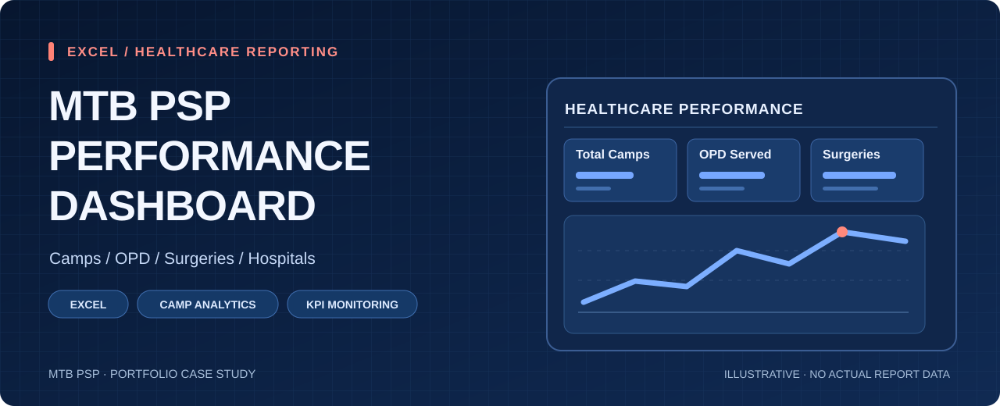

# MTB PSP Performance Dashboard

**Category:** Excel dashboard / healthcare operations reporting  
**Tool:** Microsoft Excel  
**Source examined:** `MTB PSP Performance Final(1).xlsx`

## Project overview
This Excel dashboard summarizes performance of MTB EyeSight Restoration Camps under Quasem Foundation. It tracks overall service achievement against target, date-wise service delivery, camp-level details, and hospital-wise breakdown.

## Verified Excel Dashboard Results

The MTB EyeSight Restoration Camps dashboard was reviewed in Microsoft Excel using its Dashboard, Date-wise, Camp-wise, and Hospital Breakdown worksheets.

### Key Performance Indicators

| KPI | Verified Result |
|---|---:|
| Total Camps | 15 |
| Total Service Contacts | 13,060 |
| Total Surgeries | 928 |
| Total Service Achievement | 4,678 |
| Total Service Target | 4,680 |
| Overall Achievement Rate | 99.96% |

### Hospital-wise Performance

| Hospital | Achievement | Target | Achievement Rate |
|---|---:|---:|---:|
| MEH Ulipur | 1,527 | 1,560 | 97.9% |
| MEH Rangpur | 1,566 | 1,555 | 100.7% |
| MEH Saidpur | 1,585 | 1,565 | 101.3% |
| **Total** | **4,678** | **4,680** | **99.96%** |

### Surgical Performance

| Surgery Type | Original Target | Achievement |
|---|---:|---:|
| Cataract Surgery (IOL) | 700 | 700 |
| DCR | 150 | 150 |
| DCT | 5 | 0 |
| Pterygium | 75 | 78 |
| **Total** | **930** | **928** |

### Reporting Notes

- The original DCT target was five surgeries. No DCT surgeries were performed because eligible patients were not identified.
- Pterygium achievement exceeded its original target by three surgeries.
- The Hospital Breakdown uses a different service-level target allocation, showing 80 Pterygium targets without a separate DCT row. The Dashboard retains the original approved service targets.
- Total Service Contacts represents the sum of recorded registration, refraction, medicine distribution, spectacle distribution, and surgery-advice counts. It does not represent verified unique patients.
- Dashboard calculations, source summaries, hospital comparisons, and key chart values were reviewed locally in Microsoft Excel.
- The portfolio banner is illustrative and does not depict an actual Excel dashboard screenshot.

**Data privacy:** The original workbook and underlying camp-level records are not publicly distributed.

## What the workbook shows
- **Dashboard:** KPI cards for total camps, total OPD served, total surgeries, total achievement, and overall achievement.
- **Service summary:** Cataract surgery, DCR, DCT, pterygium, medicine distribution, and optics distribution against target.
- **Hospital summary:** Performance comparison across **MEH Ulipur**, **MEH Rangpur**, and **MEH Saidpur**.
- **Date-wise summary:** Camp activity by date including registration, refraction, medicine distribution, spectacles distribution, surgery advice, total OPD, and IOL.
- **Camp-wise details:** Individual camp records with hospital, location, organizer, and surgery mix.
- **Hospital breakdown:** Service-type level target vs achievement with status and variance.

## Key headline metrics
- **Total camps:** 15
- **Total OPD served:** 13,060
- **Total surgeries:** 928
- **Total achievement:** 4,678
- **Overall achievement:** 99.96%

## Key insights
- Total achievement is effectively on target, finishing **4,678 of 4,680**.
- **MEH Saidpur** and **MEH Rangpur** slightly exceeded target, while **MEH Ulipur** remained marginally below target.
- Medicine distribution and optics distribution both hit planned targets.
- DCT underperformed relative to target, while pterygium slightly exceeded target.

## Workbook structure
- `Dashboard`
- `Date-wise`
- `Camp-wise`
- `Hospital Breakdown`

## Portfolio note
This repository is intended as a **portfolio case study**. It documents the workbook structure, metrics, and reporting design. Share the original workbook publicly only if organizational approval allows it.
